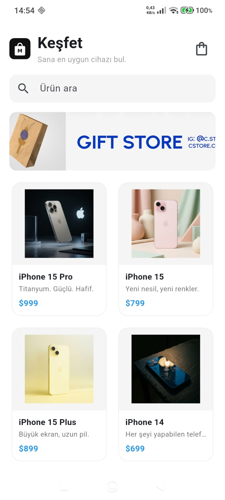
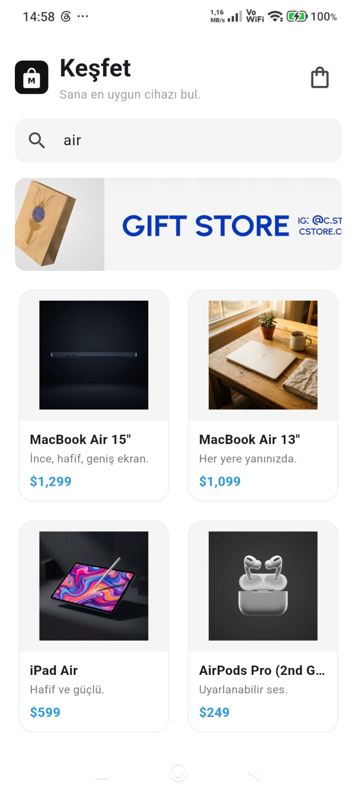
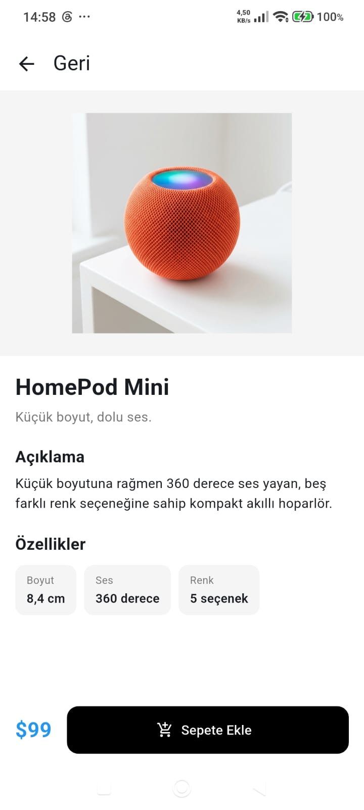
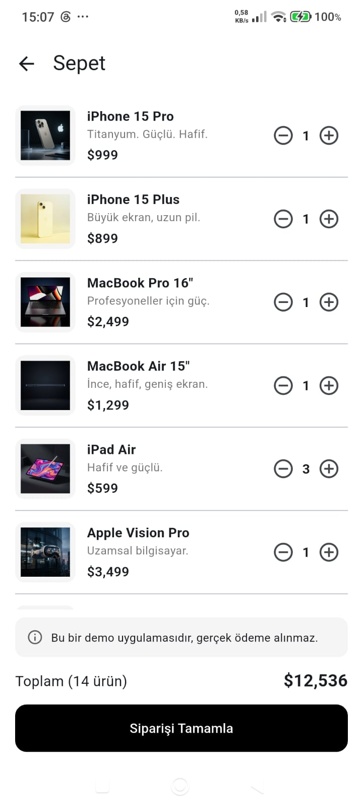
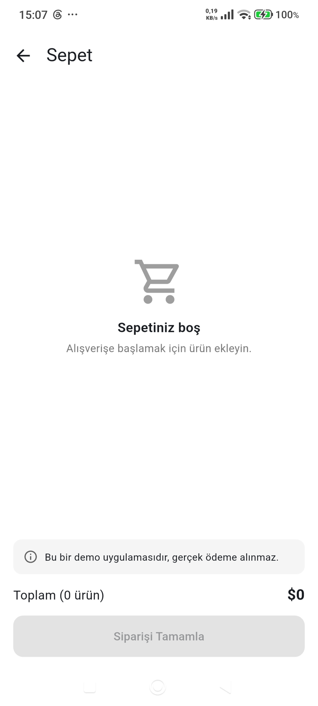

# Mini Katalog Uygulaması

Flutter ile geliştirilmiş, ürünleri listeleyen, ürün detayını gösteren ve basit bir sepet simülasyonu içeren mobil katalog uygulaması. Flutter eğitimi kapsamında bitirme projesi olarak hazırlanmıştır.

## Kısa Açıklama

Uygulama üç ana ekrandan oluşur:

- **Ana sayfa (Keşfet):** Arama kutusu, banner görseli ve ürünlerin 2 sütunlu kartlar hâlinde listelendiği GridView.
- **Ürün detayı:** Büyük ürün görseli, açıklama, özellikler ve "Sepete Ekle" butonu.
- **Sepet:** Eklenen ürünler, adet artırma/azaltma, toplam tutar ve sipariş simülasyonu. Sepet boşken boş sepet ekranı gösterilir.

Ürün verileri, `assets/data/products.json` dosyasından okunur (JSON / API simülasyonu). Veri yapısı eğitim amaçlı demo API olan https://wantapi.com/products.php adresinden örnek alınmıştır. Ürün görselleri ve banner bu demo adresten `Image.network` ile yüklenir.

## Kullanılan Sürümler

| Araç | Sürüm |
|---|---|
| Flutter | 3.47.7 (stable) |
| Dart | 3.13.5 |
| Test cihazı | Xiaomi Redmi Note 14 Pro (Android 16) |

Ekstra paket kullanılmamıştır; yalnızca Flutter SDK ve `material.dart` kullanılmıştır.

## Öne Çıkan Özellikler

- Stateless ve Stateful widget kullanımı
- `Navigator.pushNamed` ile **Named Routes** ve **Route Arguments** (ürün detay sayfasına ürün nesnesi gönderilir)
- `Product` model sınıfı, `fromJson` / `toJson` metotları
- `rootBundle` ile JSON asset okuma
- `GridView.builder` ile kart tabanlı ürün listesi, `ListView` ile sepet listesi
- `Image.asset` (uygulama logosu) ve `Image.network` (ürün görselleri)
- Ürün adına göre arama / filtreleme
- `ChangeNotifier` + `ListenableBuilder` ile basit state yönetimi (sepet rozeti ve sepet ekranı anlık güncellenir)

## Proje Klasör Yapısı

```
lib/
├── main.dart                     # Uygulama girişi, tema ve route tanımları
├── models/
│   └── product.dart              # Ürün modeli (fromJson / toJson)
├── data/
│   └── product_repository.dart   # JSON dosyasından ürünleri okur
├── state/
│   └── cart.dart                 # Sepet state yönetimi (ChangeNotifier)
├── screens/
│   ├── home_screen.dart          # Ana sayfa (arama, banner, GridView)
│   ├── product_detail_screen.dart# Ürün detay sayfası
│   └── cart_screen.dart          # Sepet sayfası
├── widgets/
│   ├── product_card.dart         # Ürün kartı
│   └── product_image.dart        # Ortak ağ görseli widget'ı
└── utils/
    └── format.dart               # Fiyat biçimlendirme
assets/
├── data/products.json            # Ürün verileri
└── images/logo.png               # Uygulama logosu
```

## Çalıştırma Adımları

1. Flutter SDK'nın kurulu olduğundan emin olun:
   ```
   flutter --version
   ```
2. Depoyu klonlayın ve proje klasörüne girin:
   ```
   git clone <bu-deponun-adresi>
   cd mini_katalog
   ```
3. Bağımlılıkları yükleyin:
   ```
   flutter pub get
   ```
4. Bir Android cihaz bağlayın (USB hata ayıklama açık) veya emülatör başlatın, ardından:
   ```
   flutter run
   ```

Not: Ürün görselleri internetten yüklendiği için cihazın internet bağlantısı olmalıdır.

## Ekran Görüntüleri

| Ana Sayfa | Arama | Ürün Detayı |
|---|---|---|
|  |  |  |

| Sepet | Boş Sepet |
|---|---|
|  |  |

## Veri Kaynağı Hakkında

Kullanılan ürün verileri ve görseller eğitim ve demo amaçlıdır; gerçek bir e-ticaret altyapısını temsil etmez.
